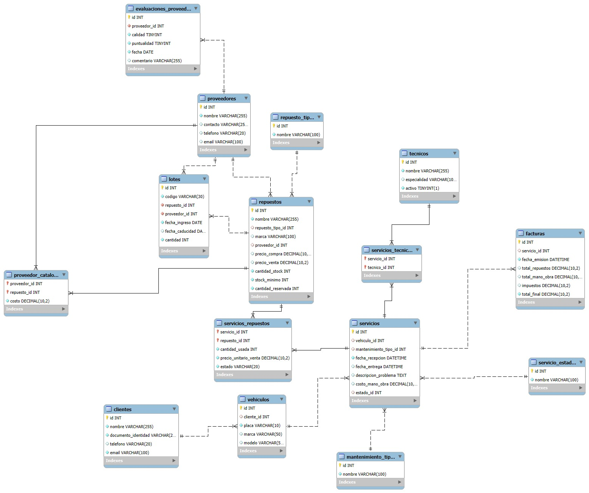
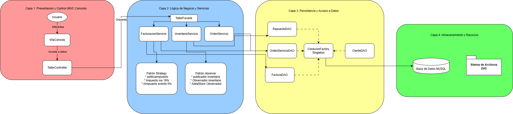

# Sistema de Gestión para el Taller Automotriz CarMotors

Sistema de Gestión de Taller (SGT) por consola, desarrollado en **Java 17 + MySQL (JDBC)** por el Grupo 02.

---

## Tabla de contenido

1. [Descripción del contexto](#descripción-del-contexto)
2. [Tecnologías utilizadas](#tecnologías-utilizadas)
3. [Funcionalidades implementadas](#funcionalidades-implementadas)
4. [Modelo de la base de datos](#modelo-de-la-base-de-datos)
5. [Instrucciones de instalación y ejecución](#instrucciones-de-instalación-y-ejecución)
6. [Arquitectura y estructura del proyecto](#arquitectura-y-estructura-del-proyecto)
7. [Decisiones de diseño](#decisiones-de-diseño)
8. [Flujo de trabajo (Git Flow)](#flujo-de-trabajo-git-flow)
9. [Autores](#autores)

---

## Descripción del contexto

**CarMotors** es un taller automotriz familiar con décadas de reputación por su honestidad y trabajo de calidad. Su gestión tradicional (agendas de papel, facturas a mano e inventario "de memoria") se convirtió en su mayor debilidad:

| Problema | Cómo lo resuelve el sistema |
|---|---|
| **Pérdida de dinero en repuestos**: no se sabe qué hay en el almacén; se compran piezas repetidas o se retrasan reparaciones por repuestos agotados. | Inventario con stock físico, reservado y disponible; ingreso de mercancía por lotes trazables; alertas automáticas de stock mínimo y caducidad. |
| **Falta de profesionalismo**: presupuestos verbales, facturas a mano y sin historial. | Facturas detalladas en texto plano (`facturas/FAC-xxxxxx.txt`) e historial completo de vehículos y servicios por cliente. |
| **Planificación ineficiente**: no se sabe qué vehículos están en espera, en proceso o listos. | Órdenes de servicio con un ciclo de vida claro (Pendiente → En Proceso → Completado → Facturado → Entregado) y asignación de técnicos. |
| **Nula visión de negocio**: no se sabe qué servicio es más rentable, qué técnico rinde más ni qué proveedor conviene. | Reportes gerenciales: servicios más solicitados, productividad por técnico, consumo de repuestos y desempeño de proveedores. |

---

## Tecnologías utilizadas

| Tecnología | Uso |
|---|---|
| **Java 17** | Lenguaje de programación (`maven.compiler.release` = 17). |
| **MySQL 8** | Base de datos relacional. |
| **JDBC** (`mysql-connector-j` 8.4.0) | Acceso a datos con `DriverManager`, `PreparedStatement` y `ResultSet`. |
| **Maven** | Compilación, dependencias y ejecución (`exec-maven-plugin`). |
| **Java NIO** (`Path`, `Files`) | Escritura de las facturas en archivos de texto plano. |
| **Lambdas y Stream API** | Reportes, búsquedas y filtros sobre colecciones. |
| **Git + GitHub** | Control de versiones con Git Flow y Conventional Commits. |

---

## Funcionalidades implementadas

El menú principal da acceso a 6 módulos. En todo el sistema, antes de pedir un dato que el usuario no tiene por qué saber de memoria (id, placa, documento, código de lote o número de orden), se muestra la **lista de opciones válidas** separada con un título y una línea, por ejemplo:

```
--- Proveedores disponibles ---
  #1   AutoPartes del Norte      Ricardo León      6075551001  ventas@autopartesnorte.example.com
  #4   Frenos y Más              Gloria Cárdenas   6075551004  contacto@frenosymas.example.com
------------------------------------------------------------
Id del proveedor asociado:
```

Las listas se filtran según la operación (por ejemplo, *Iniciar orden* solo muestra órdenes Pendientes y *Facturar* solo órdenes Completadas). Cualquier error (dato inválido, regla de negocio incumplida o error de base de datos) se informa con un mensaje `[ERROR]` y el sistema vuelve al menú sin cerrarse.

### 1. Gestión de Inventario
- **Registro detallado de repuestos**: nombre, tipo (Mecánico, Eléctrico, Lubricantes y fluidos, Frenos, Suspensión, Carrocería), marca, proveedor asociado, precio de compra, precio de venta, stock y stock mínimo.
- **Trazabilidad de lotes**: cada entrada de mercancía es un lote con **código único**, vinculado a su repuesto, su proveedor, su fecha de ingreso y (si aplica) su fecha de caducidad. Un repuesto nuevo se registra con stock 0: **el stock solo entra mediante lotes**, para que todo ingreso sea trazable.
- **Alertas automáticas**:
  - En el momento: cuando una operación deja un repuesto por debajo de su mínimo, aparece `[ALERTA] Stock bajo: ...` (patrón Observer).
  - Reporte de alertas: repuestos bajo el stock mínimo y lotes que vencen en los próximos N días.
- Búsqueda por nombre, marca o tipo; actualización de precios; corrección de caducidad; anulación de lotes ingresados por error; CRUD de tipos de repuesto.

### 2. Gestión de Servicios
- **Órdenes de servicio** por vehículo: cliente, vehículo (marca, modelo, placa), tipo de mantenimiento (Preventivo o Correctivo), descripción del problema y costo de mano de obra.
- **Recepción rápida**: registra en un solo paso el cliente (si es nuevo), el vehículo (si es nuevo) y la orden (patrón Facade).
- **Asignación de técnicos y repuestos** a la orden (solo técnicos activos; se pueden reemplazar o quitar).
- **Regla de negocio crítica**:
  - Al **asignar** un repuesto a una orden, sus unidades pasan a **"Reservado"**: el stock físico no cambia, pero ya no están disponibles para otras órdenes.
  - Al marcar la orden como **"Completado"**, las unidades reservadas se **deducen permanentemente** del inventario y el detalle pasa a `DEDUCIDO`.
  - Al quitar un repuesto o cancelar una orden Pendiente, la reserva se libera.
- **Seguimiento de estado**: `Pendiente → En Proceso → Completado → Facturado → Entregado`. Solo se permite pasar al siguiente estado (patrón State); por ejemplo, no se puede iniciar una orden sin técnico ni facturar una orden que no está Completada. Al entregar se registra la fecha de entrega.
- Gestión de técnicos: registrar, actualizar, activar/desactivar y eliminar (solo si no tienen historial).

### 3. Gestión de Clientes
- **Perfil del cliente**: datos de contacto, vehículos registrados e **historial completo** de servicios (del más reciente al más antiguo).
- Registro, actualización y eliminación de clientes y vehículos; transferencia de un vehículo a otro dueño. Las placas se normalizan a mayúsculas.
- **Recordatorios automáticos** (en Reportes): clientes a quienes se debe notificar su próximo mantenimiento preventivo, con frecuencia configurable (por defecto cada 6 meses) y días de anticipación.

### 4. Facturación y Reportes
- **Factura en texto plano**: una vez la orden está **Completada**, desde el menú *Facturación* se emite la factura, que pasa la orden a *Facturado* y se guarda en `facturas/FAC-xxxxxx.txt`. Incluye:
  - Datos del cliente y del vehículo, técnicos y problema atendido.
  - Desglose de repuestos utilizados (cantidad, precio unitario y subtotal).
  - Mano de obra, subtotal, **IVA 19 %** y total a pagar.
- Listar facturas, ver una factura y volver a exportarla a `.txt`.
- **Reportes gerenciales** (calculados con Lambdas y Streams):

| Reporte | Qué responde |
|---|---|
| Servicios más solicitados | Solicitudes por tipo de mantenimiento (con ingresos por mano de obra y repuestos) y el top de trabajos más repetidos. |
| Productividad por técnico | Órdenes terminadas y en curso, y mano de obra generada por cada técnico. |
| Consumo de repuestos | Unidades usadas y reservadas, e ingresos por repuesto. |
| Alertas de inventario | Repuestos bajo el stock mínimo y lotes próximos a caducar. |
| Recordatorios de mantenimiento preventivo | Clientes con preventivo vencido o próximo a vencer. |
| Desempeño de proveedores | Ranking por calidad y puntualidad promedio. |

### 5. Gestión de Proveedores
- **Base de datos de proveedores**: nombre, persona de contacto, teléfono y email.
- **Catálogo de productos por proveedor**: qué repuestos suministra cada proveedor y a qué costo; **comparación de precios** de un repuesto entre proveedores (del más barato al más caro).
- **Evaluación de desempeño**: calificación de 1 a 5 por **calidad** de los productos y **puntualidad** de las entregas, con comentario; corrección y eliminación de evaluaciones.

---

## Modelo de la base de datos



El script `database/schema.sql` respeta el modelo entregado en el enunciado y lo **extiende solo donde lo exigen las funcionalidades**.

**Tablas de consulta (lookup)**

| Tabla | Contenido |
|---|---|
| `repuesto_tipos` | Tipos de repuesto (Mecánico, Eléctrico, ...). |
| `servicio_estados` | Los 5 estados de una orden. En Java se representan con el `enum EstadoServicio`. |
| `mantenimiento_tipos` | Preventivo y Correctivo. En Java se representan con el `enum TipoMantenimiento`. |

**Tablas operacionales y relaciones**

| Tabla | Descripción y relaciones |
|---|---|
| `clientes` | Datos de contacto; documento y email únicos. |
| `vehiculos` | Placa única. **N:1** con `clientes` (un cliente tiene varios vehículos). |
| `proveedores` | Datos de contacto (se agregan `telefono` y `email`). |
| `repuestos` | Ficha del repuesto. **N:1** con `repuesto_tipos` y con `proveedores` (proveedor asociado). Se agregan `marca` y `cantidad_reservada`, con `CHECK` para que la reserva nunca supere el stock. |
| `lotes` *(nueva)* | Trazabilidad: código único, repuesto, proveedor, fecha de ingreso, caducidad y cantidad. **N:1** con `repuestos` y con `proveedores`. |
| `proveedor_catalogo` *(nueva)* | Tabla de unión **N:M** entre `proveedores` y `repuestos`, con el costo ofrecido. |
| `evaluaciones_proveedor` *(nueva)* | Calificaciones de calidad y puntualidad (1 a 5). **N:1** con `proveedores`. |
| `tecnicos` *(nueva)* | Técnicos del taller con especialidad y estado activo/inactivo. |
| `servicios` | Órdenes de servicio. **N:1** con `vehiculos`, `mantenimiento_tipos` y `servicio_estados`. |
| `servicios_tecnicos` *(nueva)* | Tabla de unión **N:M** entre `servicios` y `tecnicos`. |
| `servicios_repuestos` | Tabla de unión **N:M** entre `servicios` y `repuestos`, con cantidad y precio de venta del momento. Se agrega `estado` (`RESERVADO` / `DEDUCIDO`) para la regla de negocio crítica. |
| `facturas` | Totales de la factura. **1:1** con `servicios` (`servicio_id` único: una orden se factura una sola vez). |

`database/data.sql` carga datos de prueba coherentes: 8 clientes, 10 vehículos, 5 proveedores, 15 repuestos con sus 15 lotes, 19 productos de catálogo, 10 evaluaciones, 5 técnicos, 12 órdenes en todos los estados y 7 facturas.

---

## Instrucciones de instalación y ejecución

### Requisitos previos
- **JDK 17** o superior (`java -version`).
- **Apache Maven** 3.6 o superior (`mvn -v`).
- **MySQL Server** 8 en ejecución.
- **Git**.

### 1. Clonar el repositorio
```bash
git clone https://github.com/duvancovilla292-prog/proyecto-java-grupo02.git
cd proyecto-java-grupo02
```

### 2. Configurar la conexión a la base de datos
Los datos de conexión están como constantes en `src/main/java/com/carmotors/config/ConexionFactory.java`. Ajústalos a tu instalación de MySQL:

```java
private static final String URL = "jdbc:mysql://localhost:3306/carmotors";
private static final String DB_USER = "root";
private static final String DB_PASSWORD = "tu_contraseña";
```

> En un proyecto real las credenciales no se dejan en el código; se usa esta forma porque es la vista en clase (Sesión 18).

El porcentaje de IVA (19 %) y la carpeta de facturas (`facturas/`) se configuran en `src/main/java/com/carmotors/config/ConfiguracionSistema.java`.

### 3. Ejecutar los scripts SQL (en este orden)
```bash
mysql -u root -p < database/schema.sql   # 1) crea la base "carmotors" y sus tablas
mysql -u root -p < database/data.sql     # 2) carga los datos de prueba
```
`schema.sql` borra y vuelve a crear las tablas, así que puede ejecutarse de nuevo para dejar la base limpia.

### 4. Compilar y ejecutar
```bash
mvn compile exec:java
```
Al iniciar, el sistema comprueba la conexión con MySQL. Si falla, muestra el motivo y cómo corregir la configuración. Las facturas se guardan en la carpeta `facturas/` dentro de la carpeta desde donde se ejecuta el proyecto.

---

## Arquitectura y estructura del proyecto



El diagrama de clases está en [`docs/diagrama-clases.jpeg`](docs/diagrama-clases.jpeg).

```
proyecto-java-grupo02/
├── src/main/java/com/carmotors/
│   ├── Main.java       ← punto de entrada: crea la consola y el menú principal
│   ├── vista/          ← VISTA: menús, tablas y lectura de datos por consola (sin lógica de negocio)
│   ├── controlador/    ← CONTROLADOR: recibe la opción elegida y llama a la capa de servicio
│   ├── servicio/       ← SERVICIO: reglas de negocio, cálculos, validaciones y orquestación
│   │   ├── estado/     ←   patrón State (ciclo de vida de la orden)
│   │   ├── impuesto/   ←   patrón Strategy (cálculo del impuesto)
│   │   └── observador/ ←   patrón Observer (alertas de stock)
│   ├── dao/            ← REPOSITORIO: interfaces DAO, una por entidad
│   │   └── jdbc/       ←   implementaciones con JDBC y MySQL
│   ├── modelo/         ← MODELO: entidades de las tablas, enums de las tablas de consulta
│   │   └── reporte/    ←   objetos con los resultados de los reportes
│   ├── config/         ← ConexionFactory (Singleton) y ConfiguracionSistema
│   └── excepcion/      ← excepciones propias del dominio
├── database/           ← schema.sql y data.sql
├── docs/               ← diagramas ER, de clases y de arquitectura
├── pom.xml
└── .gitignore
```

**Flujo de una petición:** `Vista` (lee el dato) → `Controlador` (elige la acción) → `Servicio` (aplica las reglas) → `DAO` (SQL) → MySQL.
Ejemplo: al **completar una orden**, `OrdenServicioServicio` valida la transición de estado, pide a `InventarioServicio` deducir cada repuesto reservado (que usa `RepuestoDAO`), actualiza el detalle con `DetalleRepuestoDAO` y cambia el estado con `OrdenServicioDAO`.

---

## Decisiones de diseño

### Principios SOLID

| Principio | Dónde se aplica |
|---|---|
| **S** - Responsabilidad única | Cada capa tiene una sola tarea: las vistas solo muestran y leen, los controladores solo coordinan, los servicios aplican reglas y los DAO solo ejecutan SQL. `ConexionFactory` solo entrega conexiones; el IVA y la carpeta de facturas se separaron en `ConfiguracionSistema`. `Formato` concentra el formato de pesos y columnas. |
| **O** - Abierto/cerrado | Un impuesto nuevo se agrega creando otra clase que implemente `PoliticaImpuesto`, sin modificar `FacturacionServicio`. Un estado nuevo se agrega con otra clase `EstadoOrden`. Un módulo nuevo se agrega extendiendo `ControladorBase` sin tocar su ciclo de menú. |
| **L** - Sustitución de Liskov | Cualquier `EstadoOrden`, `PoliticaImpuesto` u `ObservadorInventario` puede usarse donde se espera la interfaz. Los seis controladores se usan como `ControladorBase`. |
| **I** - Segregación de interfaces | Interfaces pequeñas y específicas: un DAO por entidad (`ClienteDAO`, `RepuestoDAO`, ...), `VistaMenu` (solo título, opciones y texto de salida), `AccionMenu` y `Listado` (un solo método). |
| **D** - Inversión de dependencias | Los servicios guardan sus DAO como **interfaces** (`private final RepuestoDAO repuestoDAO`) y no dependen de la implementación JDBC. `FacturacionServicio` depende de la abstracción `PoliticaImpuesto`, no de un impuesto concreto. |

### Patrones de diseño

| Patrón | Tipo | Dónde | Por qué |
|---|---|---|---|
| **Singleton** *(obligatorio)* | Creacional | `config/ConexionFactory`, `servicio/observador/PublicadorInventario` | Una sola fábrica de conexiones para toda la aplicación y una sola lista de observadores de inventario (`private static final INSTANCIA` + constructor privado). |
| **DAO** *(obligatorio)* | Acceso a datos | `dao/` (interfaces) y `dao/jdbc/` (implementaciones) | Aísla todo el SQL; los servicios no conocen JDBC. |
| **Builder** | Creacional | `modelo/OrdenServicioBuilder` | Crea órdenes con muchos datos opcionales y valida todo en `build()` (estado Pendiente y fecha actual por defecto). |
| **Facade** | Estructural | `servicio/TallerFacade` | La recepción rápida coordina cliente, vehículo y orden en un solo paso. |
| **State** | Comportamiento | `servicio/estado/` (`EstadoPendiente`, `EstadoEnProceso`, ...) | Cada estado decide cuál es el siguiente y si la orden admite técnicos y repuestos; evita cadenas de `if`. |
| **Strategy** | Comportamiento | `servicio/impuesto/` (`ImpuestoIva`, `ImpuestoExento`) | El cálculo del impuesto se cambia sin tocar la facturación. |
| **Observer** | Comportamiento | `servicio/observador/` | Cuando el stock baja del mínimo, el inventario publica la alerta y la consola la muestra, sin que el inventario conozca la vista. |
| **Command** | Comportamiento | `controlador/AccionMenu` | Cada opción del menú es un comando registrado con una lambda en un `Map`. |
| **Template Method** | Comportamiento | `controlador/ControladorBase.iniciar()` | El ciclo "mostrar menú → leer opción → ejecutar → manejar error" se escribe una vez (método `final` con hooks `alIniciar` / `alSalir`). |

### Programación funcional (Lambdas y Streams)
- **Reportes** (`ReporteServicio`): `stream().filter(...).sorted(comparador).toList()` con comparadores escritos como lambdas.
- **Búsquedas y filtros**: búsqueda de repuestos por texto, órdenes por estado, técnicos activos, historial del cliente y comparación de precios por proveedor.
- **Cálculos**: total de repuestos de la factura con `map(...).reduce(0, Integer::sum)`.
- **Menús**: cada opción se registra con una lambda (`registrar("1", () -> registrarRepuesto())`), y las listas de referencia también se pasan como lambdas.

### Otras decisiones
- **Las tablas de consulta como `enum`**: `servicio_estados` y `mantenimiento_tipos` tienen valores fijos que el código necesita conocer (por ejemplo, para las transiciones de estado), por eso se representan con `enum` cuyos ids coinciden con los de la tabla, en lugar de un DAO.
- **`ReporteDAO`**: los reportes cruzan varias tablas (`JOIN`, `GROUP BY`), así que no pertenecen a una sola entidad; tienen su propio DAO de solo lectura para que MySQL haga las sumas y no se carguen tablas completas en memoria.
- **Factura separada de "Completar"**: el enunciado tiene un estado *Facturado* propio, por eso la factura se emite como un paso aparte (desde *Facturación*), solo para órdenes *Completadas*.
- **Montos en pesos enteros (`int`)**: los pesos colombianos no usan centavos; el IVA se redondea al peso más cercano.
- **Excepciones propias** (`CarMotorsException` y sus subclases): permiten mostrar un mensaje claro y volver al menú en vez de cerrar la aplicación.

---

## Flujo de trabajo (Git Flow)

- `main`: solo versiones estables.
- `develop`: rama de integración principal.
- `feature/<funcionalidad>`: una rama por funcionalidad, creada desde `develop` e integrada con Pull Request (por ejemplo `feature/gestion-inventario`, `feature/facturacion`, `feature/reportes`).

Los commits siguen **Conventional Commits** en inglés: `feat:`, `fix:`, `docs:`, `refactor:`, `chore:`.

El archivo `.gitignore` excluye la carpeta de compilación (`target/`), los `*.class`, la configuración de los IDE (`.idea/`, `.vscode/`, `*.iml`), los `*.log` y las facturas generadas (`facturas/`).

---

## Autores

**Grupo 02**

- Ciel Covilla
- Exneider Nava
- Andrés Rueda
- *(completar: integrante con usuario de GitHub `felizin_tk`)*
